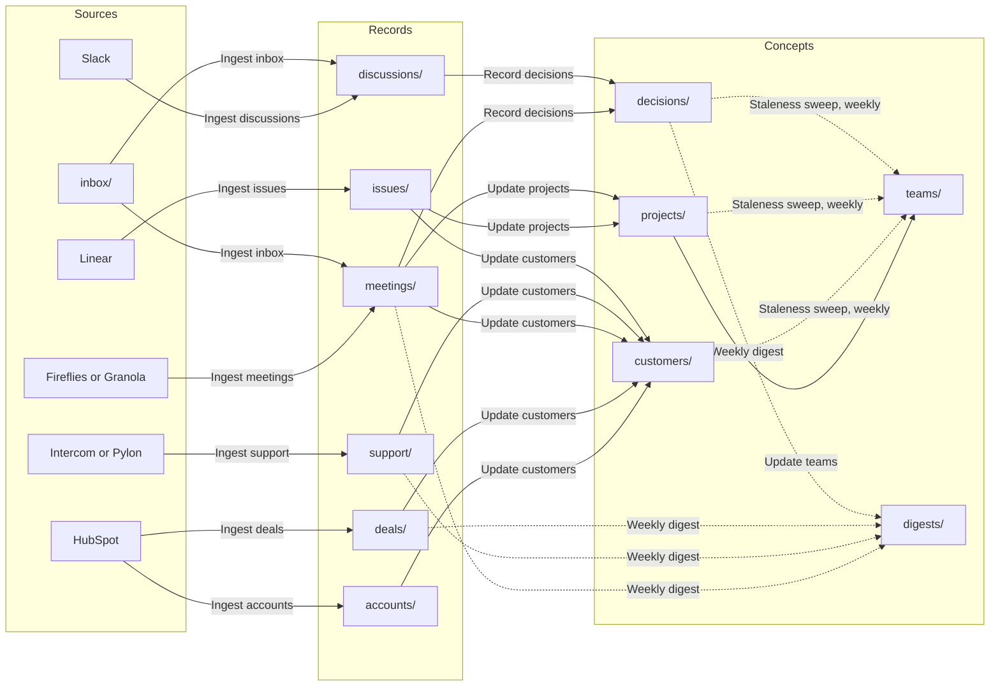

# Company brain

This repo keeps what a company knows about its customers, projects and decisions in one place, built from what the company already produces: meetings, support conversations, CRM accounts and deals, issues and Slack threads. Workflows turn each of those into a record, then join them into a page per customer, a page per project and a page per decision, with the reasons and who decided. Each team's page lists the pages that have gone stale, so they get checked instead of quietly going out of date. Every change lands on a branch for review. It works without any connection, since meeting notes and chat threads can be pasted into `inbox/`. It starts with example data for Acme, a fictional shipping company, so you can see it work first.

## How it works

Ingest workflows turn source events into records, one file per event. Refinement workflows read across records and keep the concept pages current. Every change a refinement makes lands on its own branch for review, and refinements run again only when that branch merges.



## Try it

Northline Freight's renewal waits on one date: when the webhook delivery log keeps 30 days of history. Here's the call where Acme gives that date, using the example data.

1. Open `customers/northline.md`. Northline is on watch: its 186,000 USD renewal closes on 15 December, and it won't sign without 30 days of delivery history. Then open `projects/webhook-delivery-log.md`, where keeping 30 days has no owner or date.
2. On a new branch, add `inbox/northline-renewal-call.md` with the notes from the call:

   ```text
   Northline Freight: delivery log and renewal, 9 November 2026
   Attendees: Sam Reyes, Priya Raman, Hana Novak (Acme), Ines Duarte (Northline Freight)

   Ines: Our auditors need 30 days of webhook delivery history. With 7 days we can't sign.
   Priya: Partitioning shipped, so the webhook delivery log project can keep 30 days now.
   We can ship it by 1 December. Jonah will own it.
   Sam: Then we commit to 1 December, for every plan, and put it in the renewal.
   Ines: If it's live by 1 December, we'll sign the two-year renewal before the 15th.
   Hana: I'll tell you when it's live.
   ```

   Ingest inbox writes a Meeting record in `meetings/` on your branch, linked to Northline and the Webhook delivery log project, and moves the original to `archive/`.
3. Merge the branch. Three workflows each open a branch:
   - Update customers updates `customers/northline.md`: the renewal now has a path to signing, with the date it depends on.
   - Update projects updates `projects/webhook-delivery-log.md`: a target date of 1 December, and Northline's renewal as the reason.
   - Record decisions adds a decision to `decisions/` to keep 30 days of delivery log history from 1 December, with the reasons and who decided, citing the call.
4. Review the customer page and the decision, and merge them. Merge the project branch too, and Update teams updates the Web team's page.

To see the staleness sweep, open `teams/payments.md` and `teams/shipping-core.md`. Their Needs review sections list `customers/pinecrest.md` and `customers/tidewater.md`, which nobody has checked since their review dates passed.

## Connections

Each ingest workflow reads one tool through the connection named in its `on.connector`. A connection made from a plugin in the marketplace takes the plugin's name, so adding the plugin is enough. Every ingest workflow ships, and one whose connection doesn't exist never runs, so connect only the tools you use. Connect two tools for the same records, like two issue trackers, and both run side by side. You can always drop material into `inbox/`.

Each connector trigger polls a read-only tool with the arguments under `on.with`.

- `fireflies`: Ingest meetings from Fireflies, which polls the latest transcripts.
- `granola`: Ingest meetings from Granola, which polls meetings from a fixed date. Set `from_date` to the day you connect it.
- `intercom`: Ingest support threads from Intercom, which polls closed conversations.
- `pylon`: Ingest support threads from Pylon, which polls closed issues.
- `hubspot`: Ingest accounts and Ingest deals from HubSpot, which poll companies and deals by last change.
- `linear`: Ingest issues from Linear, which polls issues by last update.
- `slack`: Ingest discussions from Slack, which polls one channel. Set `channel_id` to a channel where decisions get made, like `#deals`, and copy the workflow file once for each other channel.

`fireflies`, `intercom`, `pylon`, `hubspot` and `slack` aren't marketplace plugins yet, so their workflows wait for them. To use one now, add a connector of your own with that name. `granola` and `linear` are in the marketplace.

Fireflies, Intercom and Pylon don't sort their results, so a busy account may run the ingest workflow more often than it needs to. Each run skips what it already has.

Records link the customer's account by file name, like `/accounts/northline.md`. A meeting with a company the CRM hasn't synced yet still links it, and the link resolves once HubSpot sends the company. Without a CRM, Update customers creates a draft Customer page for every company a meeting, support thread or issue names.

## Starting with your own data

When you create a repo from this template, the app asks, for each kind of record, which tool you use or where the records come from. Pick a tool, and its ingest workflow stays. Pick Something else, or, where no tool is listed yet, Somewhere else, and records of that kind come in through `inbox/`. Either way, Acme's example records of that kind are left out, and so are the pages built from them and the pages built from those, like the customer pages and the digest for support conversations, or the project pages and the Team pages that read them for issues. Pick Use example data, or skip the question, and Acme's records of that kind stay. You can mix them: your own issues next to Acme's example meetings, say.

When some example records stay, they run the refinements once when the repo is created, and those runs write the left-out pages again from them, each on a branch for you to review. Pages built from other kinds stay, and may still cite a left-out page until their refinement next rewrites them.

If you start with no example data at all, connect your tools, or paste a meeting's notes into `inbox/`. Update customers creates a draft page for each customer the records name, and Update projects and Update teams do the same for projects and teams. Review each draft, fill in what the workflow couldn't know, like a team's lead and channel, and remove `status: draft`.

## Removing the example data

If you explored with Acme's example data and now want your own, delete the example on a branch and merge it:

- Every `mock-*` record, in `meetings/`, `support/`, `deals/`, `issues/` and `discussions/`, and the six example accounts in `accounts/`: `bramble.md`, `harbor.md`, `kestrel.md`, `northline.md`, `pinecrest.md` and `tidewater.md`.
- Everything in `customers/`, `projects/`, `decisions/`, `teams/` and `digests/`. These pages are built from the example records, and the refinements write them again from yours.

To remove one kind only, like the example meetings once you connect your notes tool, delete its `mock-*` records. The pages that cite them keep those footnotes until a refinement rewrites them from your own records.

Deleting files triggers no workflow. Keep `types/`, `workflows/`, `inbox/`, `archive/` and `index.md`. `log.md` keeps the example's lines until you clear them.

## Folders

Concepts, kept current by refinement workflows.

- `customers/`: one page per customer, joining its account, deals, meetings, support threads and issues, with its health and why.
- `projects/`: one page per project, with its progress, the customers it's for and its risks.
- `decisions/`: one page per decision from a meeting or a thread, with the options, the reasons and who decided.
- `teams/`: one page per team, with its projects, its customers and the pages it needs to review. There are no pages about individual people.
- `digests/`: one summary per week.

Records, one file per source event. Workflows never edit them after ingest.

- `accounts/`: companies from the CRM, named after the company, like `accounts/northline.md`.
- `deals/`: deals from the CRM.
- `meetings/`: meeting transcripts and notes, from Fireflies, Granola or `inbox/`.
- `support/`: closed support conversations, from Intercom or Pylon.
- `issues/`: issues from Linear.
- `discussions/`: threads from chosen Slack channels, or `inbox/`.

Everything else:

- `inbox/`: drop pasted text or files here. Ingest inbox sorts them into records and moves the originals to `archive/`.
- `archive/`: inbox items that have been processed.
- `types/`: one definition per type, with the fields it uses.
- `workflows/`: the workflows that keep this repo current.
- `index.md`: a map of every folder, with what each holds.
- `log.md`: one line per workflow run, newest first.
