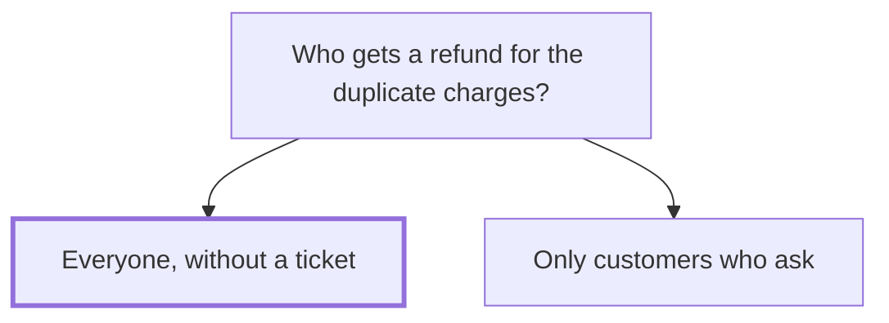

## Decision

Every label charged twice on 2 October is refunded without waiting for the customer to ask, and each affected account gets an email.[^discussions-mock-1]

## Options considered

- **Everyone, without a ticket**: Acme knows exactly which charges were duplicates.
- **Only customers who ask**: most customers would never get their money back.

## Reasons

- Acme knows exactly which charges were duplicates, and waiting for tickets means most people never get their money back.[^discussions-mock-1]
- It's about 3,100 dollars across 41 accounts.[^discussions-mock-1]

## Consequences

- Payments refunds all 41 accounts and emails each one. Support doesn't need a ticket to start a refund.[^discussions-mock-1]

## Who decided

Hana Novak, Maya Chen and Owen Brandt, on 8 October 2026.
