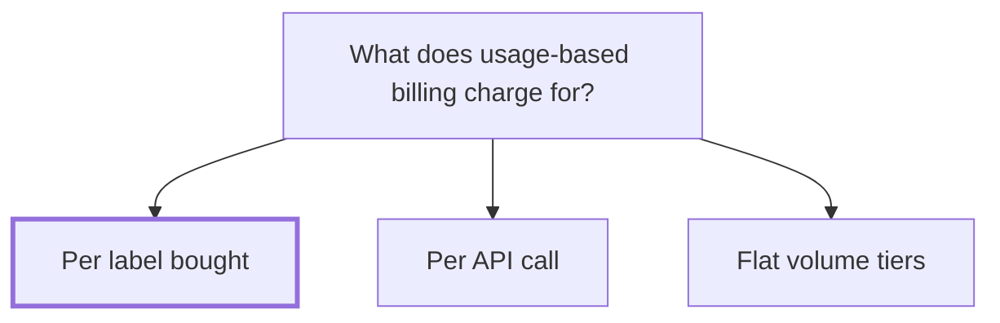

## Decision

Usage-based billing charges per label bought, not per API call or by volume tier. Rate quotes stay free.[^meetings-mock-3]

## Options considered

- **Per label bought**: what customers already count.
- **Per API call**: hard to predict for Acme and for customers.
- **Flat volume tiers**: what customers have today and complain about.

## Reasons

- Customers think in labels. Nobody knows how many API calls they make.[^meetings-mock-3]
- Per call makes revenue hard to predict, since a checkout page can quote rates a hundred times for one order.[^meetings-mock-3]
- With tiers, customers pay for a tier they only fill in December.[^meetings-mock-3]

## Consequences

- Customers who show rates at checkout aren't charged for browsing. Only buying a label costs money.[^meetings-mock-3]
- A free tier is still open, and discussed separately.[^meetings-mock-3]
- [Usage-based billing](../projects/usage-based-billing.md) meters labels bought per account.

## Who decided

Maya Chen, Sam Reyes and Owen Brandt, on 14 October 2026.
