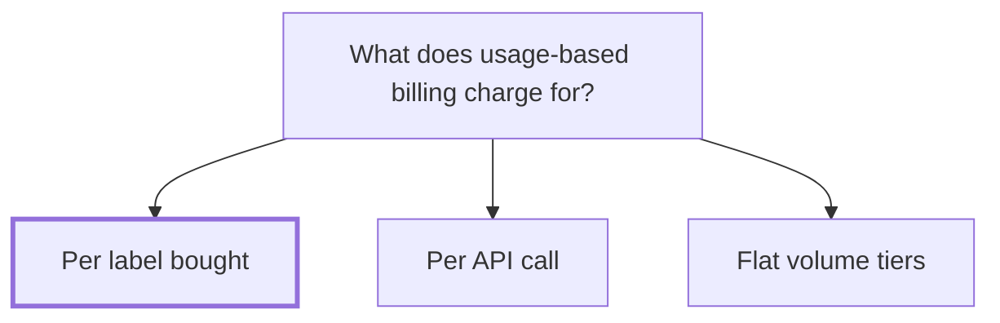

## Decision

Usage-based billing charges [per label bought](../meetings/mock-3.md), not per API call or by volume tier. Rate quotes stay free.

## Options considered

- **Per label bought**: what customers already count.
- **Per API call**: hard to predict for Acme and for customers.
- **Flat volume tiers**: what customers have today and complain about.

## Reasons

- [Customers think in labels](../meetings/mock-3.md). Nobody knows how many API calls they make.
- Per call makes [revenue hard to predict](../meetings/mock-3.md), since a checkout page can quote rates a hundred times for one order.
- With tiers, [customers pay for a tier](../meetings/mock-3.md) they only fill in December.

## Consequences

- Customers who show rates at checkout [aren't charged for browsing](../meetings/mock-3.md). Only buying a label costs money.
- A [free tier](../meetings/mock-3.md) is still open, and discussed separately.
- [Usage-based billing](../projects/usage-based-billing.md) meters labels bought per account.

## Who decided

Maya Chen, Sam Reyes and Owen Brandt, on 14 October 2026.
