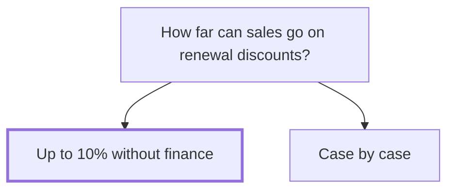

## Decision

Sales can give up to 10% off a renewal without asking finance. Anything above that needs Owen Brandt's approval, with the account's usage.[^discussions-mock-4]

## Options considered

- **Up to 10% without finance**: a clear limit sales can say no with.
- **Case by case**: last year's way, where some discounts went to 25%.

## Reasons

- Case by case let some renewals go to 25%, which is too far.[^discussions-mock-4]
- A clear limit helps account managers say no faster.[^discussions-mock-4]

## Consequences

- The renewals for [Northline Freight](../customers/northline.md) and [Kestrel Outdoor](../customers/kestrel.md) follow the limit.[^discussions-mock-4]
- Discounts above 10% go to Owen with the account's usage.[^discussions-mock-4]

## Who decided

Sam Reyes and Owen Brandt, on 20 October 2026.
