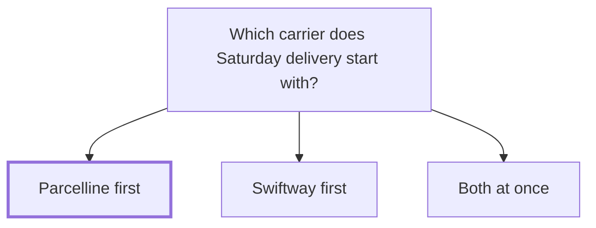

## Decision

Saturday delivery is built on Parcelline first, with Swiftway later. Lena Ito leads it, with a target of 1 February 2027.[^meetings-mock-6]

## Options considered

- **Parcelline first**: covers two of Tidewater's three regions on Saturdays.
- **Swiftway first**: covers all three, at about twice the price.
- **Both at once**: two sets of service levels in rates and in the dashboard.

## Reasons

- Parcelline covers two of Tidewater's three regions on Saturdays.[^meetings-mock-6]
- Swiftway's Saturday service costs about twice as much, which is hard to pass on.[^meetings-mock-6]
- Both at once is too much for the first quarter.[^meetings-mock-6]

## Consequences

- [Tidewater Pharmacy](../customers/tidewater.md)'s third region waits for Swiftway.[^meetings-mock-6]
- [Saturday delivery](../projects/saturday-delivery.md) targets 1 February 2027.[^meetings-mock-6]

## Who decided

Lena Ito and Sam Reyes, on 23 October 2026.
