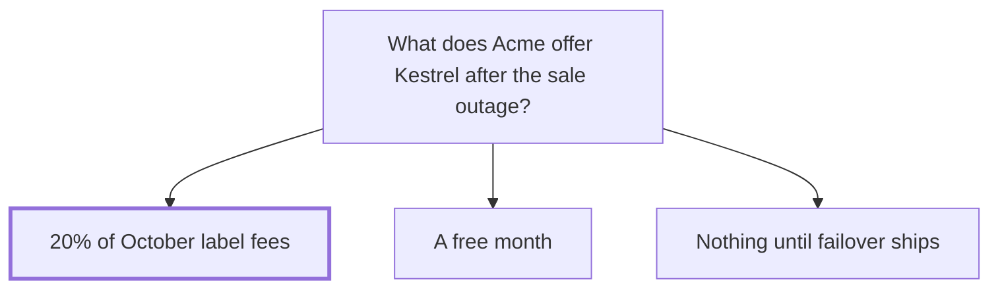

## Decision

Kestrel Outdoor gets a credit of 20% of its October label fees for the labels that failed during its sale on 24 October. Hana Novak offered it on 27 October, and Kestrel accepted.[^discussions-mock-3][^meetings-mock-5]

## Options considered

- **20% of October's label fees**: covers the late orders.
- **A free month**: more than the sale cost Kestrel.
- **Nothing until failover ships**: feels like hiding.

## Reasons

- A free month is more than the sale cost Kestrel. 20% of October's label fees covers the late orders.[^discussions-mock-3]
- Offering nothing until failover ships would feel like hiding.[^discussions-mock-3]
- Kestrel's renewal is in January, and it asked about other carriers in September.[^discussions-mock-3]

## Consequences

- Acme promised failover before Black Friday on 27 November, which [Carrier failover](../projects/carrier-failover.md) is building.[^meetings-mock-5]
- [Kestrel Outdoor](../customers/kestrel.md) took the credit, and still wants failover before Black Friday.[^meetings-mock-5]

## Who decided

Hana Novak, Sam Reyes and Owen Brandt, on 26 October 2026.
