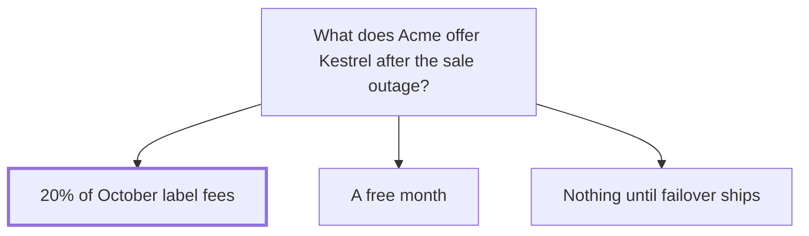

## Decision

Kestrel Outdoor gets a [credit of 20% of its October label fees](../discussions/mock-3.md) for the labels that failed during its sale on 24 October. Hana Novak [offered it on 27 October](../meetings/mock-5.md), and Kestrel accepted.

## Options considered

- **20% of October's label fees**: covers the late orders.
- **A free month**: more than the sale cost Kestrel.
- **Nothing until failover ships**: feels like hiding.

## Reasons

- A [free month](../discussions/mock-3.md) is more than the sale cost Kestrel. 20% of October's label fees covers the late orders.
- [Offering nothing until failover ships](../discussions/mock-3.md) would feel like hiding.
- Kestrel's [renewal is in January](../discussions/mock-3.md), and it asked about other carriers in September.

## Consequences

- Acme [promised failover before Black Friday](../meetings/mock-5.md) on 27 November, which [Carrier failover](../projects/carrier-failover.md) is building.
- [Kestrel Outdoor](../customers/kestrel.md) took the credit, and still [wants failover before Black Friday](../meetings/mock-5.md).

## Who decided

Hana Novak, Sam Reyes and Owen Brandt, on 26 October 2026.
