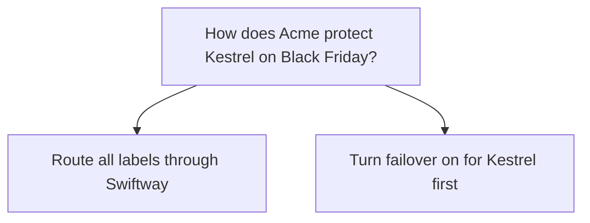

## Decision

Not decided. Hana Novak proposes sending all of Kestrel Outdoor's labels through Swiftway from 27 to 30 November, failover or not. Lena Ito would rather turn failover on for Kestrel first, and decide after the test on 20 November.[^discussions-mock-6]

## Options considered

- **Route all labels through Swiftway**: Hana's proposal, kept as the fallback plan.
- **Turn failover on for Kestrel first**: Lena's preference, if the test on 20 November goes well.

## Reasons

- Kestrel is nervous about Black Friday after labels failed again on 4 November.[^discussions-mock-6]
- Swiftway costs about 12% more per label, and nobody has said who pays the difference.[^discussions-mock-6]

## Consequences

- If it's agreed, someone decides who pays Swiftway's higher price for those four days.[^discussions-mock-6]
- [Kestrel Outdoor](../customers/kestrel.md) and [Carrier failover](../projects/carrier-failover.md) depend on the test on 20 November.

## Who decided

Proposed by Hana Novak on 4 November 2026. Nothing is agreed yet.
