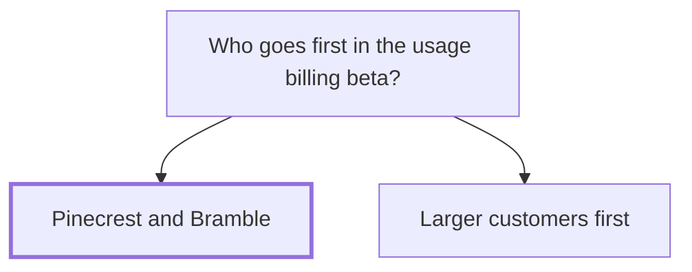

## Decision

Pinecrest Books and Bramble & Co try usage-based billing from 1 December, free during the beta.[^discussions-mock-8]

## Options considered

- **Pinecrest and Bramble**: both asked for it, and both have volume that swings a lot.
- **Larger customers first**: a billing mistake would cost more.

## Reasons

- Pinecrest asked in September and Bramble the day before. Both have volume that swings a lot.[^discussions-mock-8]
- They're small enough that a billing mistake won't hurt much.[^discussions-mock-8]

## Consequences

- [Usage-based billing](../projects/usage-based-billing.md) needs metering ready by 1 December.
- Ada Mensah tells [Pinecrest Books](../customers/pinecrest.md) and [Bramble & Co](../customers/bramble.md).[^discussions-mock-8]

## Who decided

Maya Chen, Ada Mensah and Sam Reyes, on 6 November 2026.
