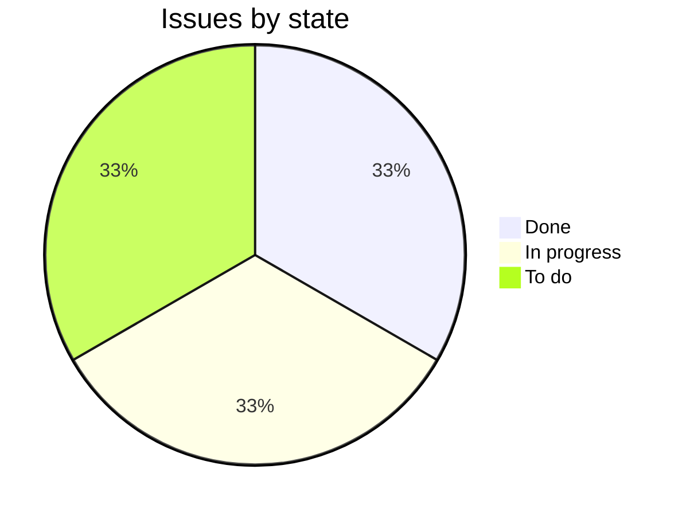

Carrier failover buys a label from Swiftway when a Parcelline label call times out, so a slow or failing carrier doesn't stop customers shipping. It's in testing against Swiftway's sandbox and on track to ship behind a flag on 20 November, a week before Black Friday.[^meetings-mock-10][^issues-mock-2]

## Progress

1 of 3 issues done.

## Who it's for

- [Kestrel Outdoor](../customers/kestrel.md): labels failed during its sale on 24 October and again in the Parcelline outage on 4 November. It needs failover working before Black Friday on 27 November.[^meetings-mock-5][^issues-mock-4]

## Open work

- ENG-246, Route label calls to Swiftway when Parcelline times out. Urgent, in progress, Tomás Silva.[^issues-mock-2]
- ENG-247, Alert when label failover kicks in. Medium, to do, unassigned.[^issues-mock-3]

## Recent meetings

- 6 November: the 4 November outage lasted about 35 minutes, and failover would have caught all of it. Testing this week, on track for 20 November behind a flag. Whether to turn it on for Kestrel first is decided after that test.[^meetings-mock-10]
- 27 October: Kestrel shipped about 1,200 orders a day late during its sale. Acme promised failover before Black Friday.[^meetings-mock-5]

## Risks

- If the test on 20 November slips, there's a week left before Black Friday.[^meetings-mock-10]
- Nobody is assigned to alerting yet, so a failover could go unnoticed by the account manager.[^issues-mock-3]
