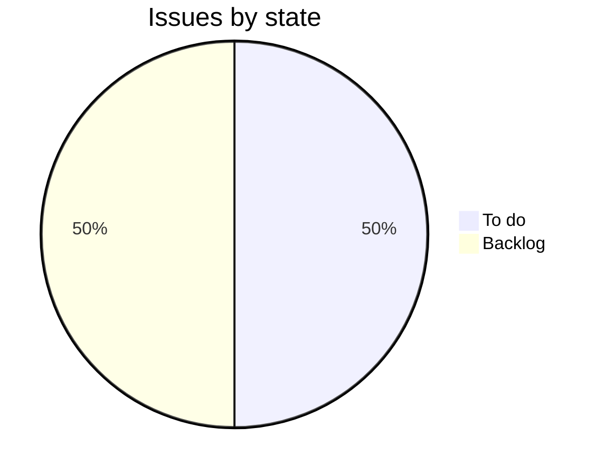

Saturday delivery lets customers ask for delivery on a Saturday where a carrier offers it. It's built on Parcelline first, with Swiftway later. Lena Ito leads it, with a target of 1 February 2027.[^meetings-mock-6]

## Progress

0 of 2 issues done.

## Who it's for

- [Tidewater Pharmacy](../customers/tidewater.md): would sign by year end if Saturday delivery is live in the first quarter, in its three regions.[^meetings-mock-2][^issues-mock-8]

## Open work

- ENG-252, Saturday delivery: Parcelline weekend service levels in rates. High, to do, Lena Ito.[^issues-mock-8]
- ENG-253, Saturday delivery: option on create shipment. Medium, backlog, unassigned.[^issues-mock-9]

## Recent meetings

- 23 October, roadmap review: Parcelline first, since it covers two of Tidewater's three regions on Saturdays and Swiftway costs about twice as much. Building both at once was too much for the first quarter.[^meetings-mock-6]
- 7 October, Tidewater discovery call: Saturday delivery is what stops Tidewater moving.[^meetings-mock-2]

## Risks

- Parcelline covers only two of Tidewater's three regions on Saturdays, so the third waits for Swiftway.[^meetings-mock-6]
