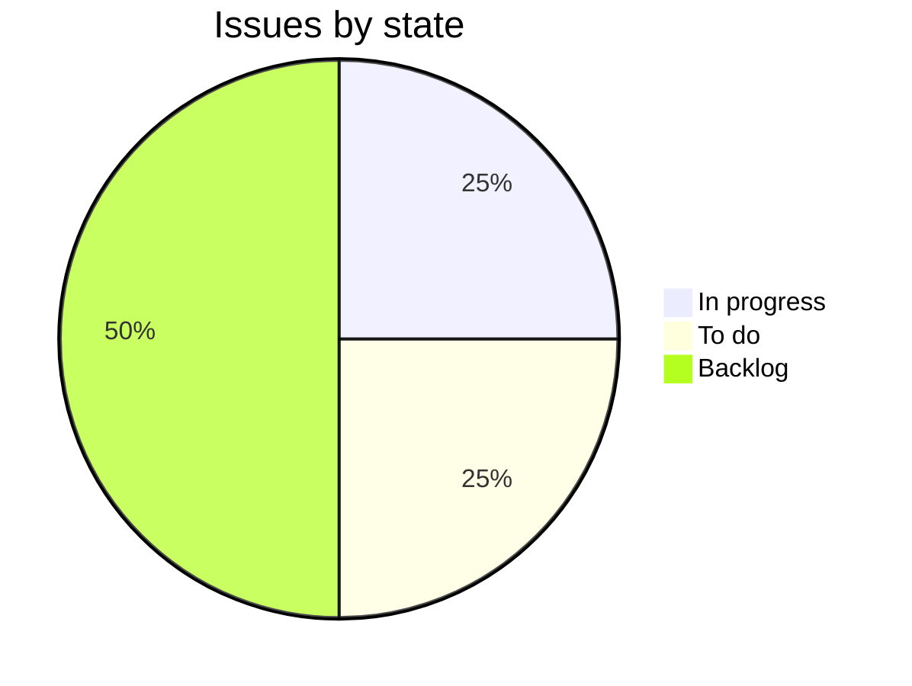

Usage-based billing charges per label bought instead of a flat volume tier, and rate quotes stay free. Metering is in progress, and a beta starts on 1 December. Maya Chen leads it.[^meetings-mock-3][^meetings-mock-9][^issues-mock-10]

## Progress

0 of 4 issues done.

## Who it's for

- [Bramble & Co](../customers/bramble.md): its volume is up about 30% since its Rotterdam warehouse opened. It joins the beta if it starts on 1 December, and asked for invoice lines per warehouse.[^meetings-mock-9][^issues-mock-12]
- [Pinecrest Books](../customers/pinecrest.md): its volume swings with the school year, and it asked for invoices that show what each label cost.[^issues-mock-11]

## Open work

- ENG-254, Meter labels bought per account. High, in progress, Dev Okafor.[^issues-mock-10]
- ENG-255, Invoice line items per label. Medium, to do, unassigned.[^issues-mock-11]
- ENG-257, Usage page in the dashboard. Medium, backlog, unassigned.[^issues-mock-13]
- ENG-256, Invoice lines per warehouse. Low, backlog, unassigned.[^issues-mock-12]

## Recent meetings

- 5 November, Bramble beta call: Bramble joins from 1 December and asked for invoice lines per warehouse, which won't be in the first version.[^meetings-mock-9]
- 14 October, pricing review: per label bought, quotes stay free. A free tier is discussed separately.[^meetings-mock-3]

## Risks

- Nobody is assigned to invoices or the usage page yet, and the beta starts on 1 December.[^issues-mock-11][^issues-mock-13]
