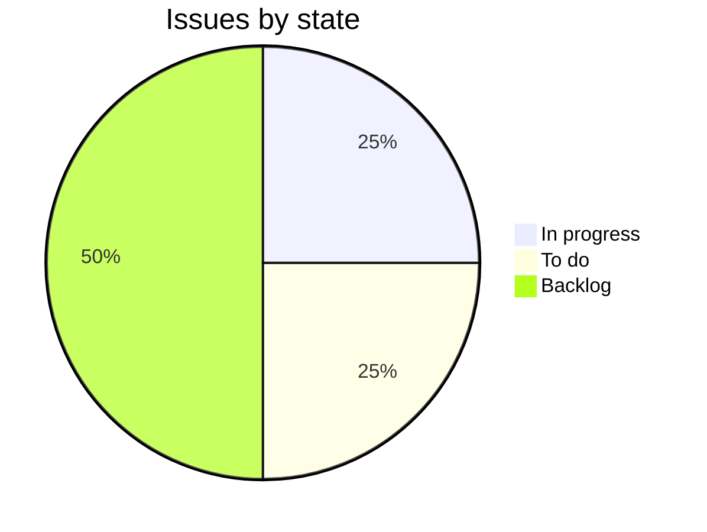

Usage-based billing charges [per label bought](../meetings/mock-3.md) instead of a flat volume tier, and rate quotes stay free. [Metering is in progress](../issues/mock-10.md), and a [beta starts on 1 December](../meetings/mock-9.md). Maya Chen leads it.

## Progress

0 of 4 issues done.

## Who it's for

- [Bramble & Co](../customers/bramble.md): its volume is up about 30% since its Rotterdam warehouse opened. It joins the [beta](../meetings/mock-9.md) if it starts on 1 December, and asked for [invoice lines per warehouse](../issues/mock-12.md).
- [Pinecrest Books](../customers/pinecrest.md): its volume swings with the school year, and it asked for [invoices that show what each label cost](../issues/mock-11.md).

## Open work

- ENG-254, [Meter labels bought per account](../issues/mock-10.md). High, in progress, Dev Okafor.
- ENG-255, [Invoice line items per label](../issues/mock-11.md). Medium, to do, unassigned.
- ENG-257, [Usage page in the dashboard](../issues/mock-13.md). Medium, backlog, unassigned.
- ENG-256, [Invoice lines per warehouse](../issues/mock-12.md). Low, backlog, unassigned.

## Recent meetings

- 5 November, [Bramble beta call](../meetings/mock-9.md): Bramble joins from 1 December and asked for invoice lines per warehouse, which won't be in the first version.
- 14 October, [pricing review](../meetings/mock-3.md): per label bought, quotes stay free. A free tier is discussed separately.

## Risks

- [Nobody is assigned to invoices](../issues/mock-11.md) or the [usage page](../issues/mock-13.md) yet, and the beta starts on 1 December.
