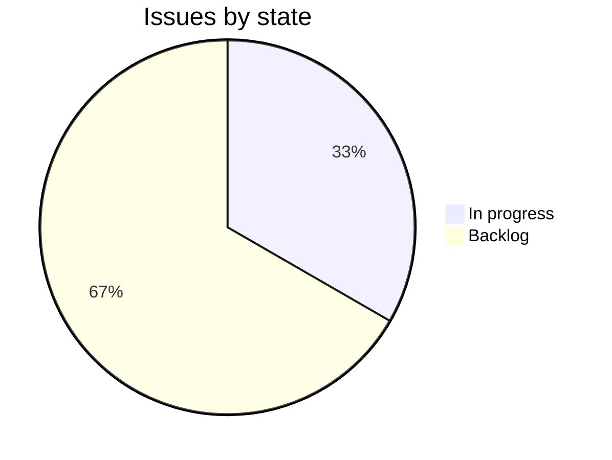

The webhook delivery log shows customers every attempt to deliver a webhook, and lets them resend a failed one. It launched on 30 October with 7 days of history. The work now is what customers asked for around launch: filters, export and a longer history.[^meetings-mock-7][^issues-mock-5]

## Progress

0 of 3 issues done.

## Who it's for

- [Northline Freight](../customers/northline.md): its auditors need 30 days of history, and its renewal depends on it.[^issues-mock-7]
- [Harbor Coffee Roasters](../customers/harbor.md): wants to export attempts as CSV for its support team.[^issues-mock-6][^meetings-mock-7]

## Open work

- ENG-251, Delivery log: keep 30 days of attempts. High, backlog, unassigned.[^issues-mock-7]
- ENG-249, Delivery log: filter by event type. Medium, in progress, Jonah Park.[^issues-mock-5]
- ENG-250, Delivery log: export attempts as CSV. Low, backlog, unassigned.[^issues-mock-6]

## Recent meetings

- 28 October: Harbor's subscription system missed shipped events. The log answers that from launch, and Harbor asked to export it.[^meetings-mock-7]

## Risks

- Keeping 30 days has no owner or date, and Northline's renewal depends on it.[^issues-mock-7]
