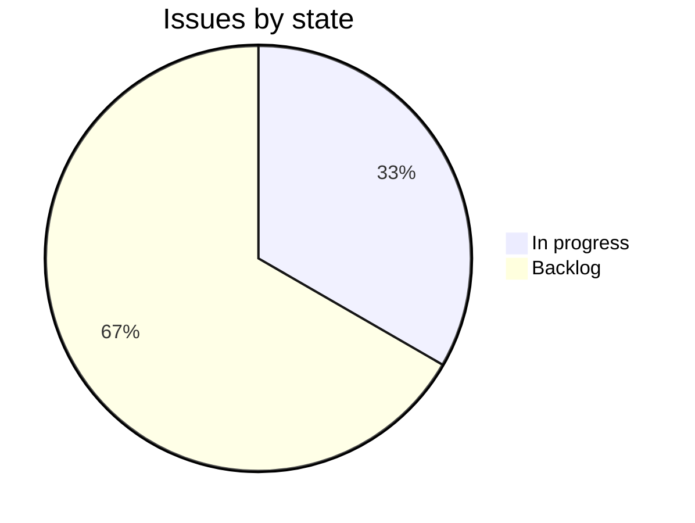

The webhook delivery log shows customers every attempt to deliver a webhook, and lets them resend a failed one. It launched on 30 October with 7 days of history. The work now is what customers asked for [around launch](../meetings/mock-7.md): [filters](../issues/mock-5.md), export and a longer history.

## Progress

0 of 3 issues done.

## Who it's for

- [Northline Freight](../customers/northline.md): its auditors need [30 days of history](../issues/mock-7.md), and its renewal depends on it.
- [Harbor Coffee Roasters](../customers/harbor.md): wants to [export attempts as CSV](../issues/mock-6.md) for its support team, as it asked at its [check-in](../meetings/mock-7.md).

## Open work

- ENG-251, [Delivery log: keep 30 days of attempts](../issues/mock-7.md). High, backlog, unassigned.
- ENG-249, [Delivery log: filter by event type](../issues/mock-5.md). Medium, in progress, Jonah Park.
- ENG-250, [Delivery log: export attempts as CSV](../issues/mock-6.md). Low, backlog, unassigned.

## Recent meetings

- 28 October, [Harbor Coffee Roasters check-in](../meetings/mock-7.md): Harbor's subscription system missed shipped events. The log answers that from launch, and Harbor asked to export it.

## Risks

- [Keeping 30 days](../issues/mock-7.md) has no owner or date, and Northline's renewal depends on it.
