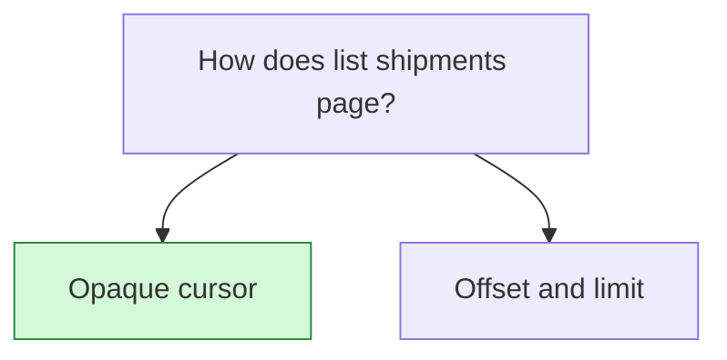

## Decision

GET /v1/shipments pages with an [opaque cursor](../specs/mock-6.md). The default page size is 50, the maximum is 200, and filters from the first request apply to every page.

## Options considered

- **Opaque cursor** (chosen): default page size 50, maximum 200, filters apply to every page.
- **Offset and limit**: keeps working until v1 is retired.

## Reasons

- The [design gives no reasons](../specs/mock-6.md) beyond the requirements themselves.

## Consequences

- [Offset pagination stays](../specs/mock-6.md) until v1 is retired.

## Who decided

Lena Ito, on 9 October 2026.
