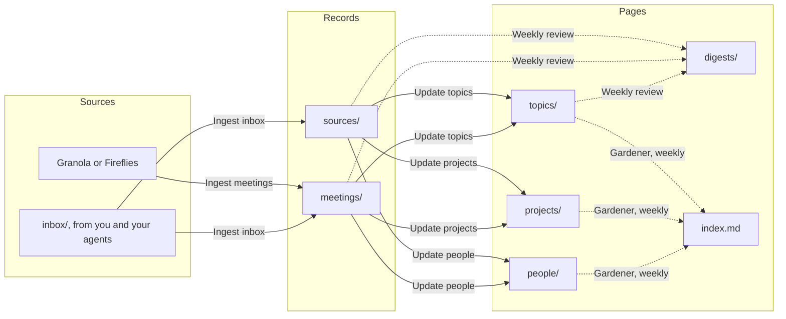

# Personal brain

This repo is one person's notes, compiled into a wiki by workflows instead of by hand. You drop what you want to keep into `inbox/`: your own notes, links, meeting notes, and summaries of conversations that any agent connected over MCP saves for you. Your meetings come in from Granola. Workflows turn each item into a record, then fold the records into a page per topic with what you currently understand and where your notes disagree, a page per project, and a page per person you keep coming back to. A weekly review sums up what you captured and what's still open, and a gardener merges duplicate topics, fixes links and keeps the page list in `index.md`. Every change lands on a branch for you to review, and any agent can read the result. It starts with example data for Maya Chen, a fictional product engineer at Acme, whose notes mix a migration she's leading, the APIs she's shipping and her one-on-ones with learning Dutch and a book she's reading, so you can see it work first.

## How it works

Ingest workflows turn what comes in into records, one file per item. Refinement workflows read across records and keep the pages current. Every change a refinement makes lands on its own branch for review, and refinements run again only when that branch merges.



## Try it

Maya hasn't decided whether the ledger migration turns on dual writes before or after the backfill, and it's due on 10 November. Here's the conversation that settles it, saved by an agent, using the example data.

1. Open `topics/zero-downtime-migrations.md`. Its Contradictions section has the open question: a write-up Maya read says dual writes first, and Dev wants to backfill first. Then open `topics/idempotency.md`, which says keys make retries safe but nothing about the backfill.
2. Connect Claude, or any agent, to this repo over MCP, talk something through, and ask it to save what you discussed. Following `AGENTS.md`, it makes a branch and adds one file to `inbox/`. To try it without an agent, make a branch and add `inbox/2026-11-09-ledger-backfill-order.md` yourself:

   ```text
   Conversation with Claude about the ledger backfill, 9 November 2026

   - Dual writes go on first, then the backfill. Anything written while the backfill runs lands in both places, so there's no catch-up run.
   - Dev's worry was the backfill fighting live writes. Idempotency keys answer it: the backfill uses each old credit's or refund's id as its key, so the Ledger refuses an entry dual writes already made and returns the first one.
   - The same keys make the backfill safe to re-run, batch by batch, after a failure.
   - Still open: how shadow invoices compare rounding. Ask Owen.
   - Agree the order with Dev Okafor on 10 November, the day shadow invoices start.
   ```

   Ingest inbox writes a Source record in `sources/` on that branch and moves the original to `archive/`.
3. Merge the branch. Update topics opens a branch that changes two topic pages:
   - `topics/zero-downtime-migrations.md`: the contradiction is settled. Dual writes come first, and the page says what settled it, citing the conversation.
   - `topics/idempotency.md`: the backfill uses the old ids as keys, which makes it safe alongside dual writes and safe to re-run.

   Update projects and Update people open branches too, for the decision on `projects/ledger-migration.md` and the commitments on `people/dev-okafor.md` and `people/owen-brandt.md`.
4. Review the topic branch. Comment on a line to ask for a change, and Update topics revises it on the same branch. Merge it when it reads right.

To see the rest, open `digests/2026-11-08.md` for last week's review with its open threads, and the Pages section of `index.md`, which the Gardener keeps. `log.md` shows the Gardener merging a duplicate Dual writes topic into Zero-downtime migrations on 2 November.

## Connections

Each ingest workflow reads one tool through the connection named in its `on.connector`. A connection made from a plugin in the marketplace takes the plugin's name, so adding the plugin is enough. Every ingest workflow ships, and one whose connection doesn't exist never runs, so connect only the tools you use. You can always drop material into `inbox/`.

Each connector trigger polls a read-only tool with the arguments under `on.with`.

- `granola`: Ingest meetings from Granola, which polls your meetings from a fixed date. Set `from_date` to the day you connect it.
- `fireflies`: Ingest meetings from Fireflies, which polls your latest transcripts.

`granola` is in the marketplace. `fireflies` isn't a marketplace plugin yet, so its workflow waits for it. To use it now, add a connector of your own with that name. Fireflies doesn't sort its results, so it may run the workflow more often than it needs to. Each run skips what it already has.

Agents don't need a connection of their own here. Any agent you connect to this repo over MCP reads `AGENTS.md`, and saves to `inbox/` on a branch.

## Starting with your own data

When you create a repo from this template, the app asks where you take meeting notes. Pick Granola, and its ingest workflow stays. Pick Something else, and meetings come in through `inbox/`. Either way, Maya's example meetings are left out, and so are the pages built from them: the topics, projects, people and the weekly review. Pick Use example data, or skip the question, and everything stays.

Maya's example notes in `sources/` always stay, since notes only come in through the inbox. When her meetings are left out, her notes run the refinements once when the repo is created, and those runs write the topic, project and person pages again from the notes alone, each on a branch for you to review.

Put your own name at the top of `index.md` once Maya's notes are gone. The workflows read it to know whose notes these are, and never write a person page for the owner.

Then drop your first notes into `inbox/`, or ask your agent to save something. Update topics starts a draft page for each subject a note is mainly about, and Update projects and Update people do the same. Review each draft and remove `status: draft`.

## Removing the example data

If you explored with Maya's notes and now want your own, delete the example on a branch and merge it:

- Every `mock-*` record, in `sources/` and `meetings/`.
- Everything in `topics/`, `projects/`, `people/` and `digests/`. These pages are built from the example records, and the refinements write them again from yours.
- In `index.md`, replace Maya Chen's name at the top with yours, and empty the Pages section. The Gardener lists your pages there from its next run.

To remove one kind only, like the example meetings once you connect Granola, delete its `mock-*` records. The pages that cite them keep those footnotes until a refinement rewrites them from your own records.

Deleting files triggers no workflow. Keep `types/`, `workflows/`, `inbox/` and `archive/`. `log.md` keeps the example's lines until you clear them.

## Folders

Pages, kept current by refinement workflows.

- `topics/`: one page per subject, with the current understanding, a Contradictions section where notes disagree, and open questions.
- `projects/`: one page per piece of work with a goal and an end, at work or not, with where it stands, decisions and next steps.
- `people/`: one page per person who comes up in two or more records, with recent conversations and open commitments. Only facts the records state, never opinions.
- `digests/`: one weekly review per week.

Records, one file per item. Workflows never edit them after ingest.

- `sources/`: one summary per item from `inbox/`: your notes, links and the conversation summaries agents save.
- `meetings/`: meetings from Granola, Fireflies or `inbox/`, with their summary and transcript or notes.

Everything else:

- `inbox/`: drop anything here. Ingest inbox turns it into records and moves the originals to `archive/`.
- `archive/`: inbox items that have been processed, exactly as they were dropped.
- `types/`: one definition per type, with the fields it uses.
- `workflows/`: the workflows that keep this repo current.
- `index.md`: whose repo this is, every page with one line each, and every folder.
- `log.md`: one line per workflow run, newest first.
- `AGENTS.md`: instructions for agents connected over MCP: read from `index.md`, write only to `inbox/`.
