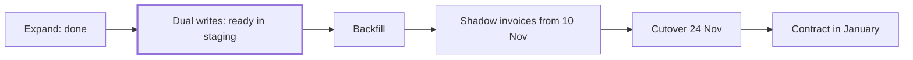

You're moving credits, refunds and two years of invoices from the old billing tables into the Ledger, so usage invoices come from one place before the beta on 1 December. ([Why I'm leading the ledger migration](../sources/mock-1.md)) Expand is done and dual writes are ready in staging. The date that matters now is 10 November, when shadow invoices have to start in production. ([Ledger migration sync](../meetings/mock-6.md), [Ledger migration sync](../meetings/mock-8.md))

## Where it stands

- Expand: done. Imported entries are marked `origin: legacy`. ([Ledger migration sync](../meetings/mock-6.md))
- Dual writes: ready in staging. ([Ledger migration sync](../meetings/mock-8.md))
- Backfill: Dev's. Two years took about three hours on the staging copy. ([Ledger migration sync](../meetings/mock-6.md), [Handing the backfill to Dev](../sources/mock-9.md))
- First shadow invoices on staging: 397 of 400 accounts match. ([Ledger migration sync](../meetings/mock-8.md))

## Next steps

- Decide with Dev: dual writes or backfill first. By 10 November. ([Ledger migration sync](../meetings/mock-8.md))
- Work out with Owen how shadow invoices compare rounding. ([Ledger migration sync](../meetings/mock-8.md))
- Start shadow invoices in production by 10 November. ([Ledger migration plan](../sources/mock-6.md), [Ledger migration sync](../meetings/mock-8.md))

## Decisions

- 21 October: Dev owns the backfill. You pair with Dev for the first week and review the dry run, row counts per month and totals per account. ([Handing the backfill to Dev](../sources/mock-9.md))
- 9 October: six steps, expand to contract, with the old tables dropped in January. ([Ledger migration plan](../sources/mock-6.md))
- 6 October: cutover on 24 November. Owen signs off after two weeks of every account matching. ([Ledger migration kickoff](../meetings/mock-2.md))

## Risks

- The order is still undecided, and shadow invoices have to start by 10 November or the 24th slips. ([Ledger migration sync](../meetings/mock-8.md))
- 3 of 400 accounts were a cent off on staging, because the old tables and the Ledger round differently. ([Ledger migration sync](../meetings/mock-8.md))
