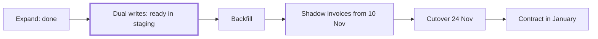

The ledger migration moves credits, refunds and two years of invoices from the old billing tables into the Ledger, so usage-based invoices can come from one place before the beta on 1 December.[^sources-mock-1] The expand step is done and dual writes are ready in staging. The next date that matters is 10 November, when shadow invoices have to start in production.[^meetings-mock-6][^meetings-mock-8]

## Where it stands

- Expand is done: the Ledger accepts imported entries marked `origin: legacy`.[^meetings-mock-6]
- Dual writes are ready in staging.[^meetings-mock-8]
- Dev owns the backfill. A test run over two years took about three hours on the staging copy.[^meetings-mock-6][^sources-mock-9]
- The first shadow invoices on staging data matched 397 of 400 accounts.[^meetings-mock-8]

## Next steps

- Decide whether dual writes or the backfill comes first. Maya and Dev, by 10 November.[^meetings-mock-8]
- Decide how shadow invoices compare rounding. Maya, with Owen.[^meetings-mock-8]
- Start shadow invoices in production. By 10 November.[^sources-mock-6][^meetings-mock-8]

## Decisions

- 21 October: Dev owns the backfill. Maya pairs with him for the first week and reviews the dry run, row counts per month and totals per account.[^sources-mock-9]
- 9 October: six steps, from expand to contract, with the old tables dropped in January.[^sources-mock-6]
- 6 October: cutover on 24 November. Owen signs off after two weeks of shadow invoices matching for every account.[^meetings-mock-2]

## Risks

- The order of dual writes and backfill is still undecided, and shadow invoices have to start by 10 November for the cutover to stay on 24 November.[^meetings-mock-8]
- 3 of 400 accounts were a cent off on staging, because the old tables and the Ledger round differently.[^meetings-mock-8]
