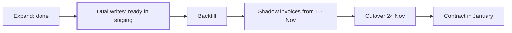

You're [moving credits, refunds and two years of invoices](../sources/mock-1.md) from the old billing tables into the Ledger, so usage invoices come from one place before the beta on 1 December. [Expand is done](../meetings/mock-6.md) and [dual writes are ready in staging](../meetings/mock-8.md). The date that matters now is 10 November, when shadow invoices have to start in production.

## Where it stands

- [Expand](../meetings/mock-6.md): done. Imported entries are marked `origin: legacy`.
- [Dual writes](../meetings/mock-8.md): ready in staging.
- [Backfill](../sources/mock-9.md): Dev's. [Two years took about three hours](../meetings/mock-6.md) on the staging copy.
- First shadow invoices on staging: [397 of 400 accounts match](../meetings/mock-8.md).

## Next steps

- Decide with Dev: [dual writes or backfill first](../meetings/mock-8.md). By 10 November.
- Work out with Owen how [shadow invoices compare rounding](../meetings/mock-8.md).
- Start [shadow invoices](../sources/mock-6.md) in production by [10 November](../meetings/mock-8.md).

## Decisions

- 21 October: [Dev owns the backfill](../sources/mock-9.md). You pair with Dev for the first week and review the dry run, row counts per month and totals per account.
- 9 October: [six steps, expand to contract](../sources/mock-6.md), with the old tables dropped in January.
- 6 October: [cutover on 24 November](../meetings/mock-2.md). Owen signs off after two weeks of every account matching.

## Risks

- The order is still undecided, and [shadow invoices have to start by 10 November](../meetings/mock-8.md) or the 24th slips.
- [3 of 400 accounts were a cent off](../meetings/mock-8.md) on staging, because the old tables and the Ledger round differently.
