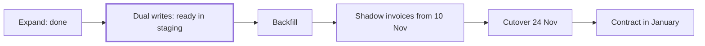

You're moving credits, refunds and two years of invoices from the old billing tables into the Ledger, so usage invoices come from one place before the beta on 1 December.[^sources-mock-1] Expand is done and dual writes are ready in staging. The date that matters now is 10 November, when shadow invoices have to start in production.[^meetings-mock-6][^meetings-mock-8]

## Where it stands

- Expand: done. Imported entries are marked `origin: legacy`.[^meetings-mock-6]
- Dual writes: ready in staging.[^meetings-mock-8]
- Backfill: Dev's. Two years took about three hours on the staging copy.[^meetings-mock-6][^sources-mock-9]
- First shadow invoices on staging: 397 of 400 accounts match.[^meetings-mock-8]

## Next steps

- Decide with Dev: dual writes or backfill first. By 10 November.[^meetings-mock-8]
- Work out with Owen how shadow invoices compare rounding.[^meetings-mock-8]
- Start shadow invoices in production by 10 November.[^sources-mock-6][^meetings-mock-8]

## Decisions

- 21 October: Dev owns the backfill. You pair with Dev for the first week and review the dry run, row counts per month and totals per account.[^sources-mock-9]
- 9 October: six steps, expand to contract, with the old tables dropped in January.[^sources-mock-6]
- 6 October: cutover on 24 November. Owen signs off after two weeks of every account matching.[^meetings-mock-2]

## Risks

- The order is still undecided, and shadow invoices have to start by 10 November or the 24th slips.[^meetings-mock-8]
- 3 of 400 accounts were a cent off on staging, because the old tables and the Ledger round differently.[^meetings-mock-8]
