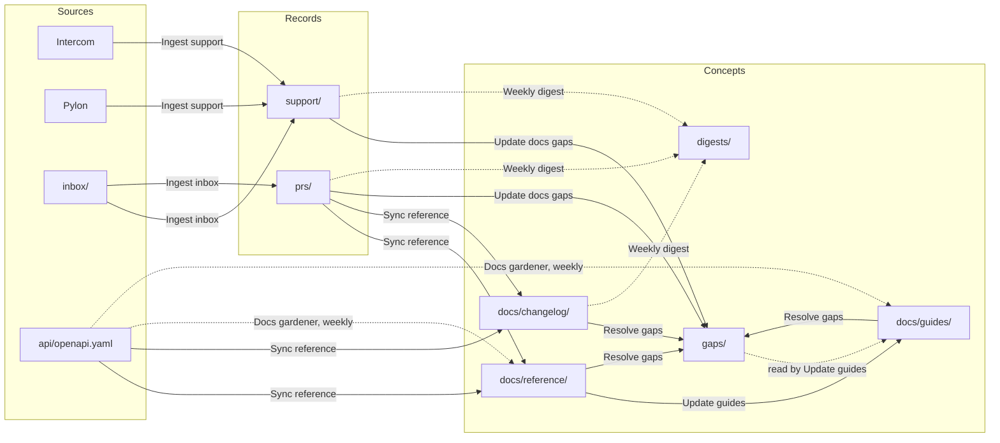

# Product docs

This repo keeps public API docs in step with two things that usually drift apart from them: the API spec and what customers ask support. Change `api/openapi.yaml`, and workflows rewrite the reference pages, add a changelog entry that says why, update the guides that use what changed, and close the questions the docs now answer. Closed support conversations that the docs don't answer become docs gaps, one per question, with every thread that asked it and a count, so writers fix the most asked first. Every change lands on a branch for review. It works without any connection, since the spec lives here and support conversations can be pasted into `inbox/`. It starts with example data for Acme, a fictional shipping company, so you can see it work first.

## How it works

Ingest workflows turn source events into records, one file per event. Refinement workflows read across records and the spec, and keep the docs current. Every change a refinement makes lands on its own branch for review, and refinements run again only when that branch merges.



## Try it

Four customers have asked support how long a rate quote is valid, and the docs don't say. Here's the spec change that answers them, using the example data.

1. Open the gap `gaps/rate-quote-validity.md`. It lists the four threads, what support told them, and the pull request that fixed quotes at one hour without changing the spec.
2. On a new branch, edit `api/openapi.yaml`. Add `expires_at` to the `RateQuote` schema's `properties` and `required`, and set `info.version` to `1.16.0`:

   ```yaml
   expires_at:
     type: string
     format: date-time
     description: When this quote's rates can no longer be bought, one hour after created_at.
   ```

3. On the same branch, add `inbox/rate-quote-expiry.md` with the pull request behind it:

   ```text
   Add expires_at to rate quotes (acme/rates-engine #163)

   Rate quotes now say when they expire. expires_at is one hour after
   created_at, the window rates have been cached for since #157. Customers
   kept asking support how long a quote lasts.
   ```

   Ingest inbox writes a Pull Request record in `prs/` on your branch and moves the original to `archive/`.
4. Merge the branch. Sync reference opens a branch that adds the field to `docs/reference/create-rate-quote.md` and writes a changelog entry in `docs/changelog/`, citing the spec and the pull request.
5. Merge that branch. Update guides opens a branch that tells readers of `docs/guides/rates-and-labels.md` to buy before `expires_at`. Resolve gaps opens another that closes `gaps/rate-quote-validity.md` and names the page that answers it.
6. Now a question nobody has asked before. On a new branch, add `inbox/saturday.md`:

   ```text
   Customer: Can we ask for Saturday delivery? We can't find it in the docs.
   Support: Some carriers deliver on Saturdays, but the API can't ask for it yet.
   ```

7. Merge it. Update docs gaps opens a branch with a new gap in `gaps/`, with one thread.

## Connections

Each ingest workflow reads one tool through the connection named in its `on.connector`. A connection made from a plugin in the marketplace takes the plugin's name, so adding the plugin is enough. Every ingest workflow ships, and one whose connection doesn't exist never runs, so connect only the tools you use. Connect two tools for the same records, like two issue trackers, and both run side by side. You can always drop material into `inbox/`.

Each connector trigger polls a read-only tool with the arguments under `on.with`.

- `intercom`: Ingest support threads from Intercom, which polls closed conversations.
- `pylon`: Ingest support threads from Pylon, which polls closed issues.

Neither `intercom` nor `pylon` is a marketplace plugin yet, so their workflows wait for them. To use one now, add a connector of your own with that name.

Neither tool sorts its results, so a busy inbox may run the ingest workflow more often than it needs to. Each run skips conversations it already has.

There's no connection for pull requests. Paste the description of a pull request that changes the API into `inbox/`, on the same branch as the spec change, and Sync reference cites it in the changelog.

## Starting with your own data

When you create a repo from this template, the app asks where your support conversations come from. Neither Intercom nor Pylon is a marketplace plugin yet, so the answers are Somewhere else, where you add support threads to `inbox/`, and Use example data. Somewhere else leaves out Acme's example support threads, and the docs gaps and digest built from them. Use example data, or skipping the question, keeps them. The reference, guides and changelog always stay, built from the example spec, `api/openapi.yaml`, and pull requests, until you replace them. Guides that cite a left-out gap keep that footnote until Update guides next rewrites them.

If you start with no example data at all, add your own OpenAPI spec at `api/openapi.yaml` and merge it. Sync reference writes one reference page per operation. Write your first guides in `docs/guides/` with `type: Guide` and the reference pages they use in `endpoints`, or let Update guides draft one when a docs gap reaches three threads. Gaps fill in as support conversations close.

## Removing the example data

If you explored with Acme's example data and now want your own, delete the example on a branch and merge it:

- Every `mock-*` record, in `prs/` and `support/`.
- `api/openapi.yaml`, Acme's spec. Add your own in its place, and Sync reference writes your reference from it.
- Everything in `docs/reference/`, `docs/guides/`, `docs/changelog/`, `gaps/` and `digests/`. These pages are built from the example spec and records.

To remove the example support threads only, once you connect your support tool, delete `support/mock-*.md`. The gaps that cite them keep those footnotes until Update docs gaps rewrites them from your own threads.

Deleting files triggers no workflow. Keep `types/`, `workflows/`, `inbox/`, `archive/` and `index.md`. `log.md` keeps the example's lines until you clear them.

## Folders

Concepts, kept current by refinement workflows.

- `docs/reference/`: one page per API operation, with its parameters, responses, errors, an example and its changes.
- `docs/guides/`: task guides that walk through the API. New ones start as drafts for review.
- `docs/changelog/`: one entry per API change, with what to do about it, named by date.
- `gaps/`: one page per question customers ask that the docs don't answer yet, with its threads and a count.
- `digests/`: one summary per week.

Records, one file per source event. Workflows never edit them after ingest.

- `support/`: closed support conversations, from Intercom, Pylon or `inbox/`.
- `prs/`: pull requests that changed how the API behaves, from `inbox/`.

Everything else:

- `api/`: the OpenAPI spec. People edit it. Workflows read it and trigger on it, and never write it.
- `inbox/`: drop pasted text or files here. Ingest inbox sorts them into records and moves the originals to `archive/`.
- `archive/`: inbox items that have been processed.
- `types/`: one definition per type, with the fields it uses.
- `workflows/`: the workflows that keep this repo current.
- `index.md`: a map of every folder, with what each holds.
- `log.md`: one line per workflow run, newest first.
