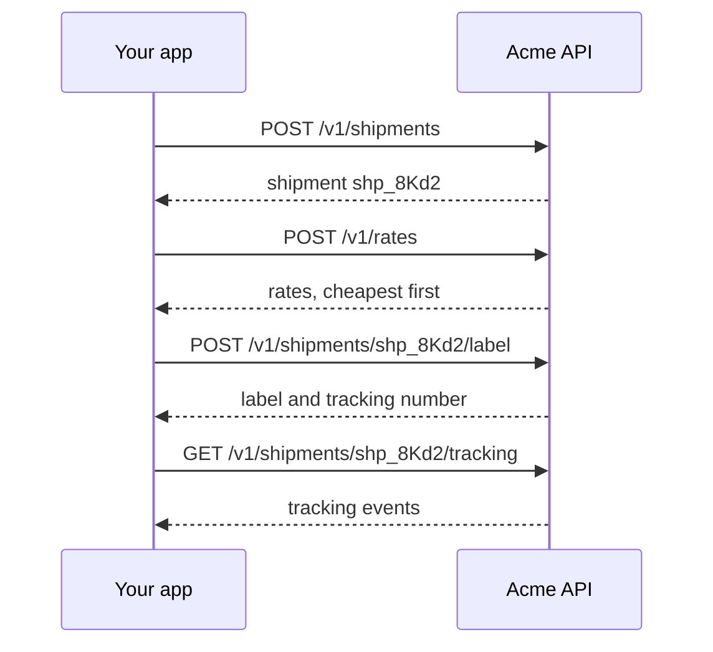

This guide takes you from an API key to a tracked parcel: create a shipment, get rates, buy a label and follow the parcel. It's for developers trying the Acme API for the first time. Use a test key, which starts with `sk_test_`, so nothing is charged or shipped.



1. **Create a shipment** with where the parcel ships from, where it's going, and its weight in grams. The response has the shipment's `id` and `status: created`.[^reference-create-shipment]

   ```bash
   curl -X POST https://api.acme.example/v1/shipments \
     -H "Authorization: Bearer $ACME_API_KEY" \
     -H "Content-Type: application/json" \
     -d '{"from":{"name":"Acme Warehouse","street1":"1 Dock Road","city":"Rotterdam","postal_code":"3011 AA","country":"NL"},"to":{"name":"Sam Lee","street1":"20 Canal Street","city":"Utrecht","postal_code":"3511 LB","country":"NL"},"parcels":[{"weight_grams":1200}]}'
   ```

2. **Get rates** for the shipment. They come back cheapest first, each with an `id`, a carrier, a service, a price and the days delivery should take.[^reference-create-rate-quote]

   ```bash
   curl -X POST https://api.acme.example/v1/rates \
     -H "Authorization: Bearer $ACME_API_KEY" \
     -H "Content-Type: application/json" \
     -d '{"shipment_id":"shp_8Kd2"}'
   ```

3. **Buy a label** with the `id` of the rate you want. The response has a `label_url` to download and print, and the `tracking_number`.[^reference-buy-label]

   ```bash
   curl -X POST https://api.acme.example/v1/shipments/shp_8Kd2/label \
     -H "Authorization: Bearer $ACME_API_KEY" \
     -H "Content-Type: application/json" \
     -d '{"rate_id":"rate_71Pq"}'
   ```

4. **Track the parcel.** Once the carrier scans it, tracking lists each event, oldest first, with an estimated delivery date.[^reference-get-tracking]

   ```bash
   curl https://api.acme.example/v1/shipments/shp_8Kd2/tracking \
     -H "Authorization: Bearer $ACME_API_KEY"
   ```

## Related

- [Create a shipment](../reference/create-shipment.md)
- [Get rates](../reference/create-rate-quote.md)
- [Buy a label](../reference/buy-label.md)
- [Get tracking](../reference/get-tracking.md)
