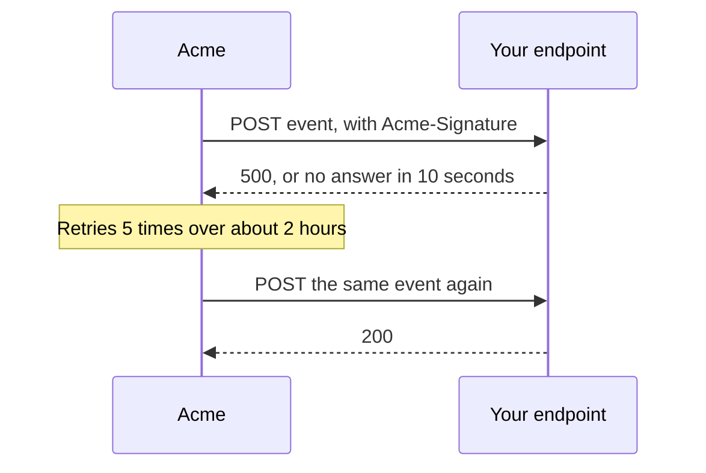

Webhooks let your app react when a shipment changes, instead of asking Acme over and over. This guide registers an endpoint, checks that each delivery came from Acme, and handles retries. It's for developers who react to shipment events.



1. **Register an endpoint** with an HTTPS URL and the events you want: `shipment.created`, `label.purchased`, `tracking.updated`, `shipment.delivered` or `shipment.returned`.[^reference-create-webhook-endpoint]

   ```bash
   curl -X POST https://api.acme.example/v1/webhook_endpoints \
     -H "Authorization: Bearer $ACME_API_KEY" \
     -H "Content-Type: application/json" \
     -d '{"url":"https://example.com/acme/webhooks","events":["tracking.updated","shipment.delivered"]}'
   ```

2. **Store the secret.** The response has a `secret`, like `whsec_9f3kQ`, and Acme never shows it again.[^reference-create-webhook-endpoint]
3. **Check the signature.** Every delivery has an `Acme-Signature` header: the hex HMAC SHA-256 of the raw request body, keyed with the secret. Compute it and compare before you trust the body.[^reference-create-webhook-endpoint]

   ```bash
   printf '%s' "$RAW_BODY" | openssl dgst -sha256 -hmac "$ACME_WEBHOOK_SECRET"
   ```

4. **Answer fast.** Return any 2xx status within 10 seconds, then do the work. A delivery that gets no answer in time has failed.[^reference-create-webhook-endpoint]
5. **Expect retries.** A failed delivery is retried 5 times over about 2 hours, then marked as failed. Every event has an `id`, so you can skip a delivery you already handled.[^changelog-2026-10-30-webhook-retries][^reference-create-webhook-endpoint]
6. **Manage your endpoints.** Listing them shows what's registered, without secrets.[^reference-list-webhook-endpoints] Deleting one stops its deliveries and drops any that are queued.[^reference-delete-webhook-endpoint]

## Related

- [Create a webhook endpoint](../reference/create-webhook-endpoint.md)
- [List webhook endpoints](../reference/list-webhook-endpoints.md)
- [Delete a webhook endpoint](../reference/delete-webhook-endpoint.md)
